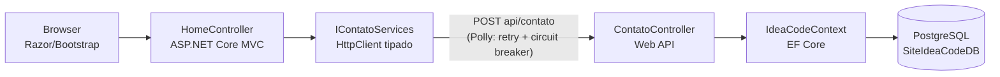

# IdeaCode — Site Institucional + API de Contato

Repositório do site institucional da **IdeaCode Desenvolvimento e Consultoria de Software LTDA** ([ideacode.me](https://ideacode.me)) — consultoria B2B em engenharia de software (treinamentos, assessment técnico, atualização de aplicações legadas, refatoração e IA corporativa) — e da API que sustenta o formulário de contato, canal principal de geração de leads do negócio.

---

## Arquitetura de Software

A solução adota uma **arquitetura em camadas (estilo Clean/DDD)**, com separação entre apresentação, aplicação, domínio e infraestrutura, distribuída em quatro projetos do solution `ideacode.me.sln`:

```
ideacode.me.sln
├── src/
│   ├── website/                 # Apresentação — ASP.NET Core MVC (site público)
│   ├── services/
│   │   └── ideacode.api/        # Aplicação/Infra — Web API (formulário de contato)
│   └── buildingblocks/
│       ├── ideacode.core/       # Núcleo de domínio compartilhado
│       └── ideacode.api.core/   # Infraestrutura de API compartilhada
└── docker/
    └── ideacode-compose.yaml    # Topologia de implantação
```

### Fluxo de requisição



1. O **website** renderiza as páginas em Razor e envia o formulário para `POST /Home/contato`;
2. O controller orquestra e delega ao serviço HTTP tipado (`ContatoServices`), que consome a **API** — com resiliência via **Polly** (retry 1s/5s/10s e circuit breaker: 5 falhas → aberto por 30s);
3. A **API** valida o input, mapeia para a entidade de domínio e persiste via **EF Core** no **PostgreSQL**.

### Camadas da API

| Camada | Conteúdo |
|---|---|
| **Presentation** | `Controllers/` (base `MainController` com envelope de resposta), `InputModel/`, `ViewModels/` |
| **Domain** | `Domain/Contato.cs` — entidade com propriedades encapsuladas (`private set`) |
| **Infrastructure – Data** | `Infra/Data/IdeaCodeContext.cs` (DbContext + Unit of Work), `Infra/Mappings/` (configuração Fluent), `Migrations/` |
| **Building blocks** | Domínio tático (`Entity`, Value Objects, Domain Events), Mediator/CQRS, JWT, contrato de repositório, helpers |

### Persistência

- **PostgreSQL 16** via `Npgsql.EntityFrameworkCore.PostgreSQL` (EF Core 8);
- Schema gerenciado por **Migrations** (`Database.Migrate()` no startup);
- **Política de datas**: datas de auditoria persistidas em **UTC** (`Kind=Utc`) em colunas `timestamp with time zone`; a conversão para o fuso de Brasília ocorre apenas na exibição;
- Segredos: **User Secrets** em desenvolvimento (fora do repositório) e **variáveis de ambiente** em produção.

### Topologia de implantação (Docker)

| Serviço | Imagem/Build | Porta |
|---|---|---|
| `site-ideacode` | `src/website` (multi-stage) | `8080` |
| `api-ideacode` | `src/services/ideacode.api` (multi-stage) | `8081` |
| `database-ideacode` | `postgres:16-alpine` | `5432` (mapeada no host) |

CI/CD: **Azure Pipelines** (`azure-pipelines.yml`) — build e push das imagens Docker no Docker Hub a partir da branch `main`.

> **PoC**: `src/websitecms` é um estudo de migração do conteúdo para **Orchard Core CMS** (net10.0 + PostgreSQL). Não faz parte do solution nem do pipeline.

---

## Design Patterns

### Em uso

| Pattern | Onde / Como |
|---|---|
| **MVC** | `website` — `HomeController` + Views Razor + Models |
| **DTO / InputModel / ViewModel** | Separação entre contrato de entrada (`ContatoInputModel`, DataAnnotations), persistência (entidade) e saída (`ContatoViewModel` com mapeamento manual) — domínio nunca vaza para a API pública |
| **Value Object** | `ideacode.core/ValueObjects` — `Email`, `Cpf`, `Cep`, `Endereco` etc.; `Email` é mapeado como *Owned Type* no EF |
| **Entity + Domain Events** | `Entity` (identidade, auditoria, coleção de eventos) e publicação de eventos no `Commit()` via mediator |
| **Unit of Work** | `IdeaCodeContext.Commit()` — `SaveChangesAsync` + publicação dos eventos de domínio |
| **Mediator / CQRS** | `IMediatorHandler` + MediatR registrado na API (comandos/consultas como `IRequest`) |
| **Base Controller + Response Envelope** | `MainController` padroniza respostas `{ success, data, errors }` |
| **Options Pattern** | `IOptions<HttpUrls>` para a URL da API no website |
| **Typed HttpClient + DelegatingHandler** | `ContatoServices`/`Service` com handler de autenticação prontos para uso |
| **Resilience (Retry + Circuit Breaker)** | Polly no pipeline do HttpClient do website (`PollyExtensions.EsperarTentar`) |
| **Fluent Configuration** | `IEntityTypeConfiguration<T>` + `ApplyConfigurationsFromAssembly` (convention over configuration) |
| **Repository / UoW (contratos)** | `IRepository<T>`, `IUnitOfWorks` definidos em `ideacode.core` |
| **Claims-based Authorization** | `CustomAuthorize`/`[ClaimsAuthorize]` e JWT (`JwtConfig`) disponíveis em `ideacode.api.core` |

### Referenciados/parcialmente utilizados

- **CQRS completo (MediatR handlers)** e **FluentValidation**: infraestrutura registrada nos projetos, sem handlers/validadores concretos ainda — evolução prevista;
- **Repositório**: contrato definido; hoje a API consulta via `DbContext` diretamente no controller.

---

## Tecnologias

### Backend

| Tecnologia | Uso |
|---|---|
| .NET 8 / ASP.NET Core | Website (MVC) e Web API |
| Entity Framework Core 8 | ORM, migrations, Fluent mapping |
| PostgreSQL 16 + Npgsql | Banco de dados |
| MediatR | Desacoplamento de comandos/eventos |
| Polly | Resiliência em chamadas HTTP |
| Swashbuckle (OpenAPI) | Swagger em Development |
| FluentValidation / Newtonsoft.Json | Validação e serialização (building blocks) |

### Frontend

| Tecnologia | Uso |
|---|---|
| Razor (ASP.NET Core MVC) | Renderização das páginas |
| Bootstrap 5.3 + Bootstrap Icons | Layout responsivo e ícones |
| Template eStartup (BootstrapMade) | Base visual do site |
| AOS / GLightbox | Animações de scroll e lightbox |
| jQuery + jquery.mask | Máscara de telefone no formulário |
| Google Fonts / GA4 | Tipografia e analytics |

### Infraestrutura & DevOps

| Tecnologia | Uso |
|---|---|
| Docker / Docker Compose | Empacotamento e orquestração local |
| Azure Pipelines | CI (build/push de imagens) |
| .NET User Secrets | Segredos em desenvolvimento |
| Git / GitHub | Versionamento (`git@github.com:AlexandreNasc12/ideacode.git`) |

---

## Como executar

### Pré-requisitos

- [.NET SDK 8](https://dotnet.microsoft.com/download/dotnet/8.0)
- Docker + Docker Compose

### 1. Banco de dados

```bash
docker compose -f docker/ideacode-compose.yaml up -d database-ideacode
```

Ou use um PostgreSQL local e crie o usuário/banco:

```sql
CREATE ROLE ideacode WITH LOGIN PASSWORD '<sua-senha>';
CREATE DATABASE "SiteIdeaCodeDB" OWNER ideacode;
```

### 2. Segredos de desenvolvimento (User Secrets)

```bash
cd src/services/ideacode.api
dotnet user-secrets set "ConnectionStrings:DefaultConnection" \
  "Host=localhost;Port=5432;Database=SiteIdeaCodeDB;Username=ideacode;Password=<sua-senha>;Timeout=30"
```

### 3. Migrations

```bash
dotnet ef database update --project src/services/ideacode.api/ideacode.api.csproj
```

> A API também aplica as migrations automaticamente no startup (`Database.Migrate()`).

### 4. Executar

```bash
# Terminal 1 — API (http://localhost:5034)
dotnet run --project src/services/ideacode.api

# Terminal 2 — Website (http://localhost:5294)
dotnet run --project src/website
```

### 5. Tudo via Docker (produção)

```bash
docker compose -f docker/ideacode-compose.yaml up -d --build
```

| Serviço | URL |
|---|---|
| Website | http://localhost:8080 |
| API | http://localhost:8081/api/contato |

---

## Estrutura de pastas (detalhe)

```
src/
├── website/
│   ├── Controllers/          # HomeController (site + contato)
│   ├── Views/                # Index, serviços (Treinamentos, Assessment, IA...)
│   ├── Services/             # ContatoServices (chamada à API)
│   ├── Configuration/        # HttpUrls (Options)
│   └── wwwroot/assets/       # CSS/JS/img do template
├── services/
│   └── ideacode.api/
│       ├── Controllers/      # ContatoController
│       ├── Domain/           # Contato (entidade)
│       ├── Infra/            # DbContext, mappings
│       ├── InputModel/       # Contratos de entrada
│       ├── ViewModels/       # Contratos de saída
│       └── Migrations/       # Schema PostgreSQL
└── buildingblocks/
    ├── ideacode.core/        # Entity, VOs, Mediator, Polly, e-mail
    └── ideacode.api.core/    # MainController, JWT, HttpClient base
```
